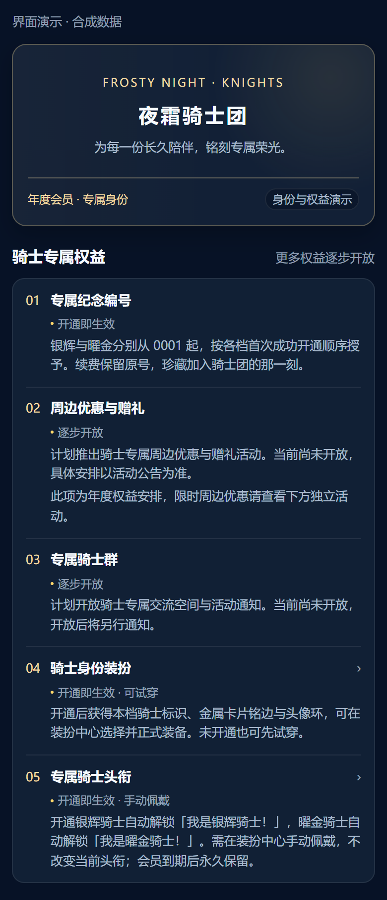
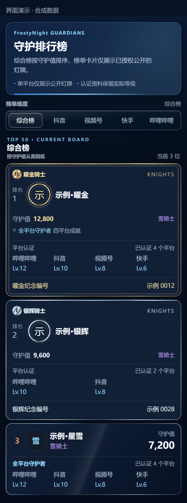
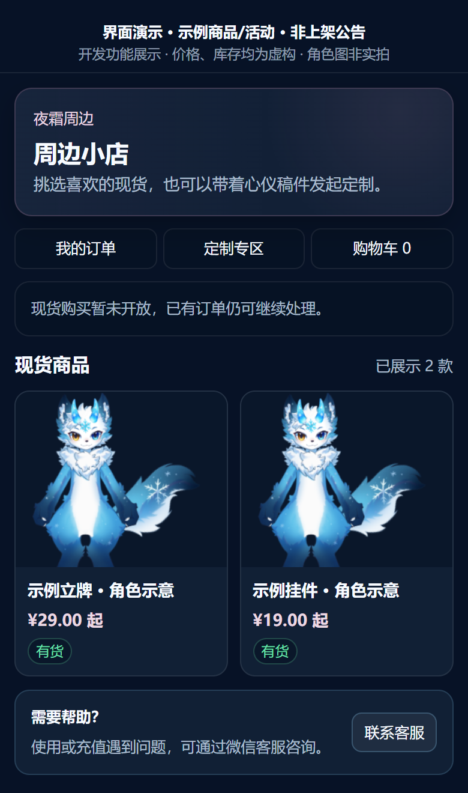
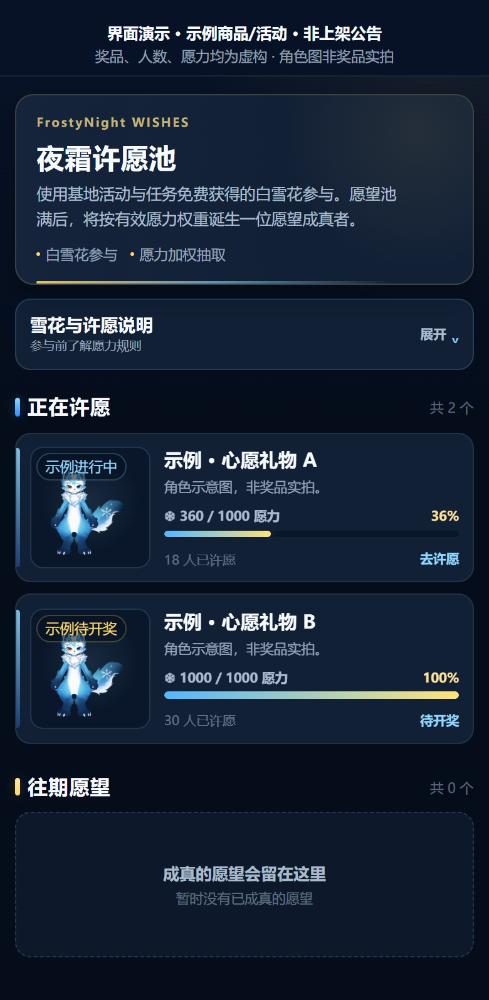
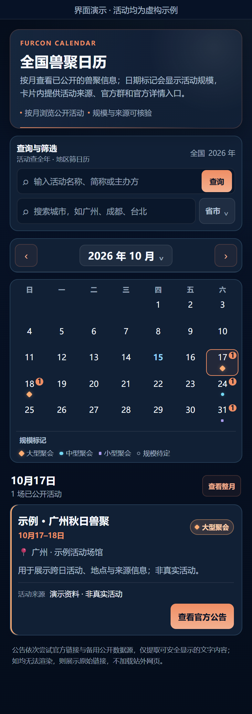
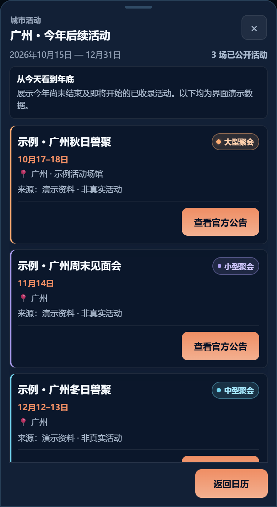
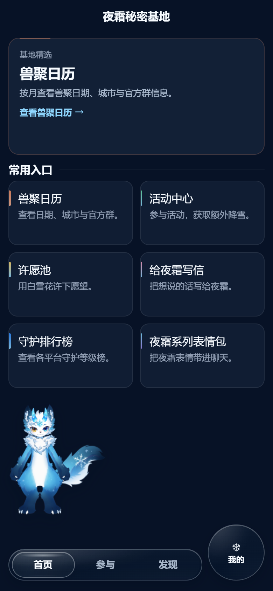

# 夜霜秘密基地

**让更多人看见夜霜，也让每一份喜欢都有归处。**

夜霜秘密基地把**公域曝光与私域维护**连接在一个微信小程序里：用全国兽聚日历、创作者发现与合作内容吸引新朋友；用骑士团、守护值排行榜、周边、许愿池与日常互动，持续经营已经建立的陪伴关系。

用户可以从查一次活动、认识一位创作者开始，自然接触夜霜的内容与形象。喜欢夜霜之后，也有一个稳定的基地，让分散在不同平台上的关注与支持得到记录，让身份可以展示，让互动持续发生。

## 公域曝光：给新朋友一个进入的理由

公域部分面向更广泛的 Furry 圈用户。第一次认识夜霜的人，也能先找到有用或感兴趣的内容。

| 入口 | 用户获得什么 | 对曝光的价值 |
| --- | --- | --- |
| **全国兽聚日历** | 按城市、月份和关键词查找已公开的活动，核对日期、场地与来源。 | 以实际查询需求建立访问入口，让用户在找活动的过程中认识基地。 |
| **Furry Up 创作者与合作画师** | 发现创作者、创作方向、公开作品资料与合作信息。 | 为圈内创作者提供展示机会，让人与内容在基地被发现。 |
| **夜霜系列表情包** | 打开微信表情合集，把喜欢的表情带进聊天。 | 让角色形象进入日常交流，延伸内容的触达场景。 |

## 私域维护：让认识之后的关系持续发生

基地把身份、支持记录、活动和实体收藏放在同一个空间，为已经关注夜霜的朋友提供持续参与的理由。

<table>
  <tr>
    <td align="center" valign="top">
      
<strong>骑士团 · 身份与归属</strong>

      
      
让陪伴拥有专属身份。 年度身份、纪念编号与装扮，让归属可以被认出。

    </td>
    <td align="center" valign="top">
      
<strong>守护值排行榜 · 支持的记录</strong>

      
      
让长期支持留下记录。 汇集认证平台与支持记录，呈现持续积累的守护值。

    </td>
  </tr>
  <tr>
    <td align="center" valign="top">
      
<strong>周边 · 实体收藏</strong>

      
      
把喜爱带到日常生活。 商品、定制与订单服务承接收藏；演示不代表已开放购买。

    </td>
    <td align="center" valign="top">
      
<strong>许愿池 · 共同期待</strong>

      
      
让日常参与有所期待。 用免费白雪花汇集愿力，查看当期进度与结果。

    </td>
  </tr>
</table>

以上为当前项目界面的演示渲染，人物、数值、商品与活动均使用合成示例；实际权益与服务开放状态以小程序内展示为准。

### 骑士团 · 身份与归属

骑士团围绕年度会员身份组织权益，通过银辉、曜金档位、纪念编号、身份装扮和专属头衔，让一段陪伴拥有可辨认、可延续的身份。有效会员可将已装备的骑士卡面展示在个人档案与守护榜中，专属骑士头衔在会员到期后仍保留。

会员身份与守护值、排名及免费成就分别计算，开通骑士会员本身不会直接增加守护值。骑士群与周边赠礼逐步开放；限时周边优惠作为独立活动，按活动状态提供，具体安排以小程序内公示为准。

### 守护值排行榜 · 让支持被看见

基地将已认证的平台等级与按规则认可的支持记录汇集为守护值，提供综合榜与分平台展示。用户可以查看自己的积累，也能认识其他守护者，让不同平台上的关注与支持形成一份持续的守护档案。

头衔、免费成就与骑士卡面分别表达不同身份；用户可以管理自己的公开展示状态。排行榜为长期陪伴提供可见的记录和交流话题。

### 周边 · 把喜爱带到日常生活

周边把角色形象、纪念与线上陪伴延伸到实体收藏。小店与定制服务围绕商品或定制需求、订单进度和后续服务展开，让一次支持得到持续承接，也让收藏成为与夜霜有关的具体记忆。

现货购买、新定制申请及相关优惠按实际开放状态提供；尚未开放的入口不代表已经可以下单。已有订单按页面提供的入口查询和处理。

### 许愿池 · 给日常参与一个共同期待

用户通过基地活动与任务获得免费的白雪花，再投入许愿池，参与当期愿望活动、查看进度与结果。许愿池将日常参与连接到具体期待，为持续回到基地提供动力。

许愿池按当期规则和有效愿力抽取结果，不保证获得奖励；金雪花不能用于许愿。白雪花的免费参与路径与会员消费、实物周边购买分别运行。

每日降雪、给夜霜写信与查看回信、头衔和装扮、夜霜大事记，则提供更轻量的回访与表达方式，让用户按自己的节奏积累基地经历。

**产品希望连接的体验：查活动／发现创作者 → 认识夜霜 → 建立守护档案 → 参与互动 → 持续陪伴与支持。** 公域内容带来发现，私域功能延续关系。

## 重点界面：全国兽聚日历

想看看本城接下来有哪些兽聚，或为某个月的出行寻找活动？可以先选城市，再按月份查看日历；已经知道活动名称时，也可以直接搜索所选年份的已收录活动。

| 你想查什么 | 可以怎样找 |
| --- | --- |
| 本城今年还有哪些活动？ | 搜索城市或选择省市，查看从今天到当年年底的已公开活动。 |
| 某个月、某一天有什么活动？ | 切换月份，在月历中查看活动场次与规模标记；点选日期查看当天，或返回整月列表。 |
| 记得名称，却忘了举办时间？ | 按活动名称、城市或场地等关键词搜索所选年份，搜索结果不受当前地区筛选影响。 |
| 时间、地点和消息来源是什么？ | 查看活动卡片中的日期、城市、场地和来源；有公开资料时还可查看更新时间、官方群及联系方式。 |

日历区分大型、中型、小型与规模待定活动，跨日活动会标记在对应日期上。活动公告支持在页面内阅读公开文字；无法读取时提供原始来源链接，方便继续核对。地区筛选支持中国大陆、香港、澳门和台湾地区；具体收录与活动安排以小程序和主办方最新公告为准。

<table>
  <tr>
    <td align="center" valign="top">
      
      
<strong>按月查看活动</strong> 日期、场次与规模在月历中集中呈现。

    </td>
    <td align="center" valign="top">
      
      
<strong>查询本城后续兽聚</strong> 从今天到当年年底，按日期浏览已收录活动。

    </td>
  </tr>
</table>

**图片说明：**本页七张图片均根据当前小程序页面模板与样式（WXML/WXSS），使用合成演示数据在浏览器中渲染，用于说明界面与操作流程。画面中的活动、用户、排名、数值、商品和日期仅作示例，不是真实用户记录、实时活动或微信真机截图；商品和权益以小程序内实际开放状态为准。

## 更多内容发现

- **Furry Up 创作者：**按昵称、标签或简介查找创作者，浏览同意公开的资料、创作方向与联创记录；也可查看页面提供的粉丝榜和月涨粉预估榜。预估根据已有数据计算，来源与更新时间以页面标注为准。
- **合作画师：**了解画师擅长方向、代表作品与约稿状态，按页面信息咨询排期。本仓库只介绍该功能，不收录画师作品。
- **系列表情包：**从小程序打开夜霜微信表情合集，把喜欢的表情添加到日常聊天中。

## 连接曝光与参与的首页

首页将公开内容和粉丝互动入口放在一起：新朋友可以从兽聚日历开始，熟悉基地的朋友可以继续参与活动、许愿、写信和查看守护榜。

  

游客首页演示：让发现基地与持续参与拥有共同入口。

具体开放功能、参与条件和服务状态以微信小程序内实际展示为准。

## 如何使用与下载资料

通过运营方公布的正式微信小程序入口进入，实际运行版本以微信内显示为准。

[GitHub Releases](https://github.com/frostynight-furry/yeshuang-secret-base-releases/releases) 提供产品介绍资料包，包含本页、更新记录、闭源说明与七张界面演示图片，方便离线查看。本次发布不提供 APK、EXE 或可独立安装的小程序包；发布标签标识公开资料版本，不代表微信审核通过或正式版本上线。

- [更新记录](CHANGELOG.md)
- [问题反馈](https://github.com/frostynight-furry/yeshuang-secret-base-releases/issues)
- [闭源与图片权利说明](NOTICE.md)

反馈时请说明设备系统、微信版本、问题现象和复现步骤。涉及个人账户或订单的问题，请使用小程序内的支持入口；公开 Issue 中请勿填写账户凭据或个人隐私信息。

产品采用闭源方式维护。本仓库仅公开产品介绍、演示图片和发布资料；GitHub 自动生成的 `Source code (zip)` / `Source code (tar.gz)` 也仅包含这些公开资料，不包含小程序或服务端源码。
