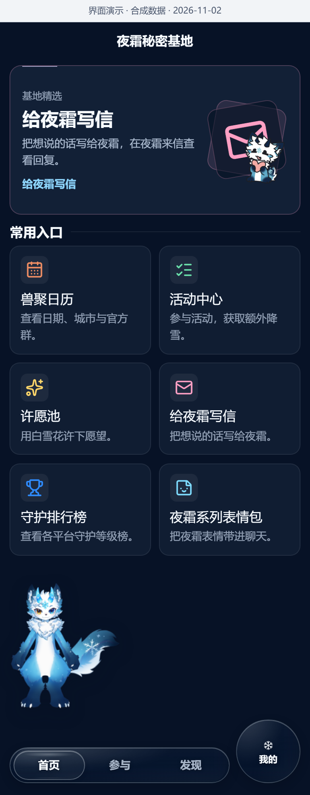
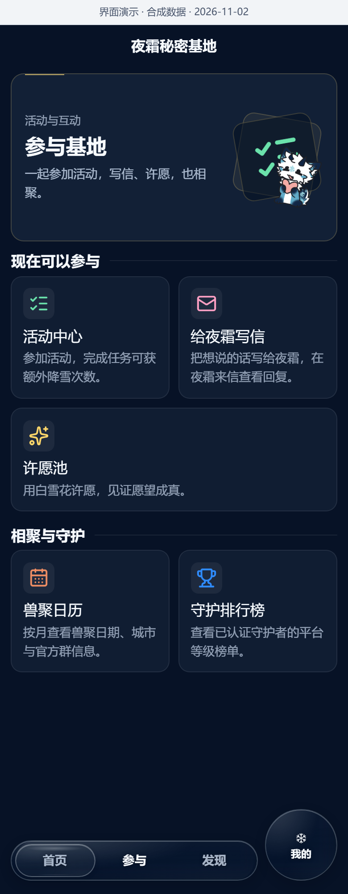
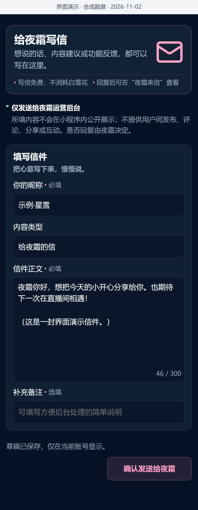
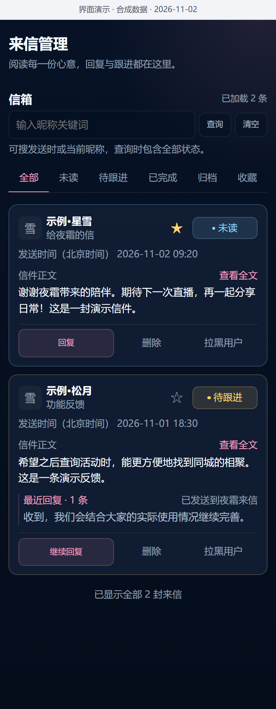
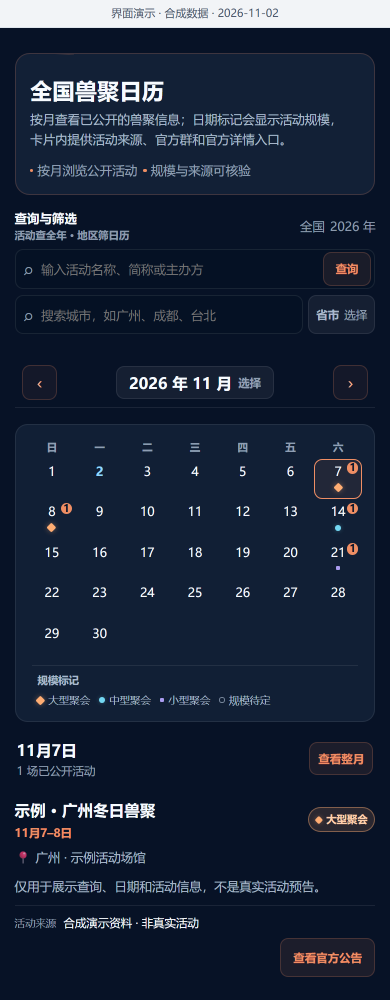
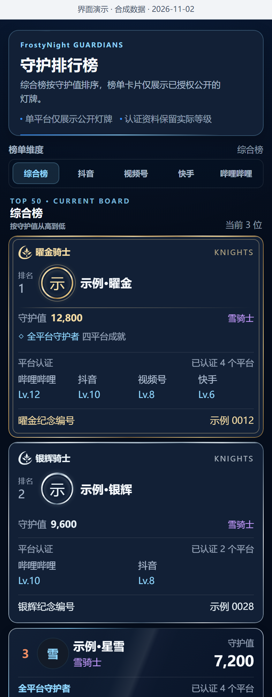
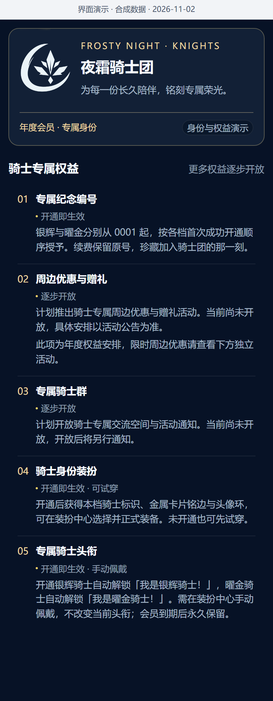
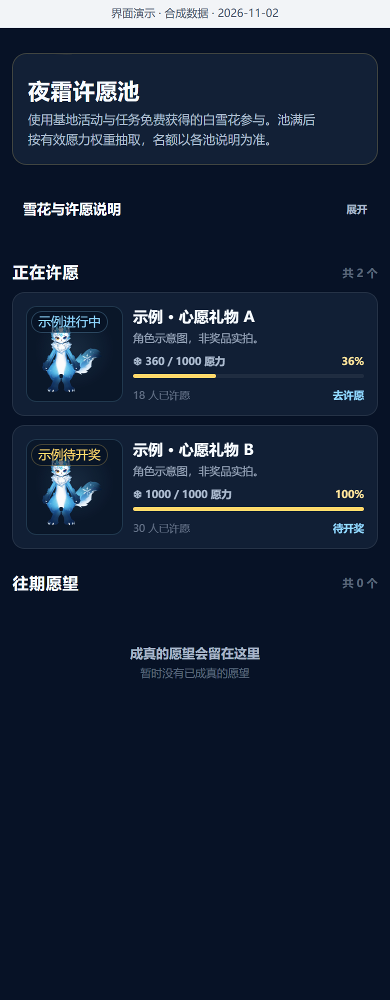
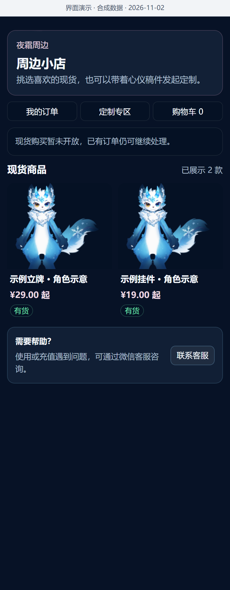

# 夜霜秘密基地

**把相遇、心意与陪伴，留在同一个基地。**

夜霜秘密基地是面向夜霜粉丝的微信小程序。你可以查询兽聚、参与基地活动与许愿、给夜霜写信并查看回信，也可以查看守护记录、管理头衔与装扮、了解骑士身份和周边服务。

**资料更新：2026-11-02。** 本页依据当前项目及已于 2026-10-29 上传的 **1.9.2 开发版**整理；开发版上传不等于微信正式版上线。实际运行版本、开放功能与参与条件以微信内展示为准。

## 从哪里开始

| 入口 | 可以做什么 |
| --- | --- |
| **首页** | 从常用入口进入兽聚日历、活动中心、许愿池、写信、守护榜与表情包。 |
| **参与** | 集中查找活动、写信和许愿入口，继续查看兽聚与守护记录。 |
| **发现** | 浏览夜霜周边、系列表情包、大事记及联创伙伴。 |
| **我的** | 查看个人守护档案、雪花资产、头衔装扮、骑士身份与自己的相关记录。 |

## 最近有哪些变化

| 版本 / 范围 | 变化 |
| --- | --- |
| **1.9.2 · 2026-10-29** | 清理选择框和卡片上的装饰箭头，保留返回、翻月等实际方向操作；折叠内容用“展开 / 收起”表达。 |
| **1.9.1 · 2026-10-29** | 优化运营端来信详情：原信使用冰蓝阅读区，多次回复使用淡粉紫时间线，短信按内容调整高度。 |
| **1.9.0 · 2026-10-28** | 统一前后台常用按钮、加载与禁用反馈，细化底部玻璃导航的选中、按压和滑动反馈。 |
| **1.6.1–1.8 系列 · 2026-10-28** | 修复历史来信读取，支持按发送时或当前昵称查询；运营端增加连续回复、收藏和处理状态，改善长信阅读、刷新与列表删除时的位置保持。 |
| **当前功能范围** | 基地围绕粉丝活动与日常陪伴运行。旧创作者 / 画师业务已迁出，兽设抠图已移除；夜霜联创伙伴仍作为公开合作内容保留。 |

上述版本有开发版上传记录；本页不据此宣称微信已审核或正式发布。更详细的资料变化见 [更新记录](CHANGELOG.md)。

## 界面一览

下列 **9 张图**均使用当前小程序页面模板与样式，配合合成演示数据在浏览器中渲染并截图，**不是微信真机截图**。每张图均带“界面演示 · 合成数据”标识；没有公开真实用户、信件或订单。骑士团图片展示权益区域，其余为页面视口展示。

<table>
  <tr>
    <td align="center" valign="top">
      
<strong>首页 · 常用入口</strong>

      
      
先找到今天想做的事。

    </td>
    <td align="center" valign="top">
      
<strong>参与 · 活动与互动</strong>

      
      
把活动、心意与相聚放在一起。

    </td>
  </tr>
  <tr>
    <td align="center" valign="top">
      
<strong>给夜霜写信</strong>

      
      
免费写信，保留草稿，在“夜霜来信”查看回复。

    </td>
    <td align="center" valign="top">
      
<strong>运营端 · 来信收件箱</strong>

      
      
按状态跟进与继续回复；此图不是用户间公开信箱。

    </td>
  </tr>
  <tr>
    <td align="center" valign="top">
      
<strong>全国兽聚日历</strong>

      
      
按月份、城市或关键词查询，核对公开来源。

    </td>
    <td align="center" valign="top">
      
<strong>守护排行榜</strong>

      
      
呈现已认证的平台等级与规则认可的支持记录。

    </td>
  </tr>
  <tr>
    <td align="center" valign="top">
      
<strong>骑士团 · 身份与权益</strong>

      
      
查看年度身份、纪念编号与权益安排。

    </td>
    <td align="center" valign="top">
      
<strong>许愿池 · 日常参与</strong>

      
      
用免费白雪花参与，查看愿力进度与活动结果。

    </td>
  </tr>
</table>

<strong>周边小店 · 商品与订单入口</strong>

现货、定制与订单服务按实际开放状态提供；图中价格、库存均为虚构，角色图不是商品实拍。

## 参与前了解这些

- **写信与回信：**写信免费，仅发送给夜霜运营后台，不在小程序内公开展示，也不提供用户间发帖、评论或私信。是否回复由夜霜决定。
- **白雪花与许愿：**白雪花通过基地降雪、活动与任务等免费路径获得；许愿按当期规则及有效愿力抽取结果，不保证获奖。金雪花不能用于许愿。
- **守护与身份：**守护值按已认证平台与认可支持记录计算；会员身份不会直接增加守护值。头衔、卡面装扮与榜单展示分别管理。
- **骑士与周边：**年度会员权益、开通状态、骑士群、赠礼及独立限时优惠以小程序内公示为准；展示界面不代表相关服务已开放。
- **兽聚资料：**日历仅展示已收录的公开活动。图中活动为虚构示例，真实日期、场地和安排请继续核对主办方公告。

## 使用、下载资料与反馈

通过夜霜公布的正式微信小程序入口进入。这里提供的是**闭源产品的公开介绍**，不提供 APK、EXE、小程序安装包或产品源码。

- [下载本次图文资料包](https://github.com/frostynight-furry/yeshuang-secret-base-releases/releases/tag/public-info-2026-11-02)
- [查看公开资料更新记录](CHANGELOG.md)
- [提交一般问题反馈](https://github.com/frostynight-furry/yeshuang-secret-base-releases/issues)
- [闭源与图片权利说明](NOTICE.md)

反馈时请说明设备、微信版本、问题现象和复现步骤。涉及个人账号、信件或订单，请使用小程序内支持入口，不在公开 Issue 中填写隐私信息。

GitHub 发布标签只标记公开资料版本。自动生成的 `Source code (zip)` / `Source code (tar.gz)` 也仅包含本仓库的介绍文档与演示图片，不包含小程序或服务端源码。
